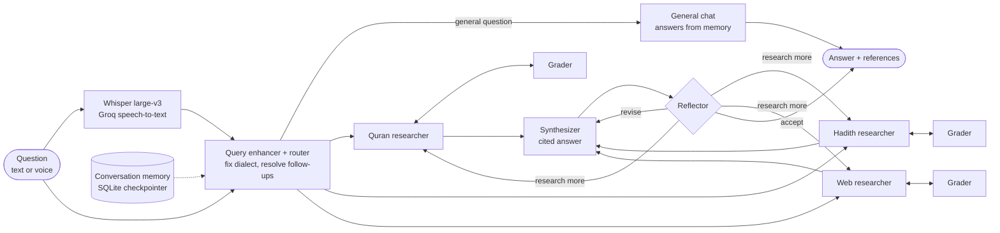

# Quran Companion: an Arabic-grounded research agent

Ask about the Quran and Sahih al-Bukhari **by text or by voice, in Arabic or English**. A team of LangGraph agents searches the Quran, the hadith collection and the web in parallel, filters every result, and answers only from what it found, with numbered citations (`surah:ayah`, hadith numbers, URLs).

- **Multi-agent pipeline**: query enhancer → 3 parallel researchers (Quran / Hadith / Web), each with a relevance grader → synthesizer ⇄ reflector.
- **General chat + memory**: non-religious questions (greetings, general knowledge, "summarize your last answer") are answered directly from the conversation. Every conversation is saved by a LangGraph SQLite checkpointer, so it survives restarts and can be reopened from the sidebar.
- **Voice questions**: speech-to-text with **Whisper large-v3 on Groq** (same API key as the LLM).
- **Streamlit chat UI**: live research timeline, right-to-left rendering for Arabic, expandable sources, follow-up questions, saved conversations.
- **Docker**: one `docker compose up` with GPU support.

> This is an AI-assisted retrieval tool, not a scholarly ruling. For religious guidance, please consult a qualified scholar.

## How it works



| Step | What it does |
|---|---|
| **Query enhancer + router** | Decides between **research** (needs the Quran, hadith or Islamic sources) and **chat** (everything else), all in the same call. For research it rewrites the question into a clear, self-contained search question: fixes spelling and dialect (e.g. Egyptian Arabic "اللي بيعق ابوه وامه" → "عقوق الوالدين"), expands vague references, and uses the conversation memory to resolve follow-ups ("what about his brother?"). |
| **General chat** | Answers greetings, general-knowledge questions and requests about the conversation ("summarize your last answer", "translate it") directly, using the last `CHAT_HISTORY_TURNS` messages, with no searches, sources or disclaimer. |
| **Memory** | The conversation (`messages`) is stored per conversation (`thread_id`) in `data/conversations.sqlite` by LangGraph's `SqliteSaver`. Per-question working state (evidence, drafts) is reset each turn; only the accepted answer (with its sources) is added to the memory. |
| **Researchers** | Three copies of one research agent run in parallel, each owning exactly one tool. Each searches up to `MAX_ROUNDS` times, rewriting its query when the grader says something is missing. |
| **Grader** | Checks every tool result against the question, keeps only relevant ones as evidence, and tells the researcher what is still missing. |
| **Synthesizer** | Writes the answer from a capped, de-duplicated, numbered source list (round-robin across tools) with inline `[n]` citations; references are added automatically. |
| **Reflector** | Verifies every claim against its cited source. It accepts, sends the draft back for revision, or asks for more research with follow-up questions (up to `LOOP_MAX` reviews). |

### Tools and data

| Tool | Source | Retrieval |
|---|---|---|
| `quran_search_tool` | Full Arabic Quran (114 surahs, 6,236 ayahs) in 5-ayah windows | `BAAI/bge-m3` + FAISS, Arabic normalization (diacritics, hamza and ya/ta-marbuta variants) |
| `hadith_search` | Sahih al-Bukhari, Arabic + English ([hadith-api](https://github.com/fawazahmed0/hadith-api)) | `BAAI/bge-m3` + FAISS, one Arabic and one English document per hadith, so either language matches |
| `duck_duck_search` | The web (tafsir, context, translations) | DuckDuckGo |

### Models (all on [Groq](https://groq.com))

| Role | Model | Falls back to (on rate limit / error) |
|---|---|---|
| Enhancer, researchers, graders (many small calls) | `openai/gpt-oss-20b` | `qwen/qwen3.8-27b` → `openai/gpt-oss-120b` → local Ollama |
| Synthesizer, reflector (the answer and its check) | `openai/gpt-oss-120b` | `qwen/qwen3.8-27b` → `openai/gpt-oss-20b` → local Ollama |
| Speech-to-text | `whisper-large-v3` | — |

Groq's free tier limits **each model separately** (8k tokens/min and 200k tokens/day per model). Splitting the work across models and falling back automatically means a used-up quota no longer stops the app. If [Ollama](https://ollama.com) is running with `qwen3:14b` pulled, it is added as the last, unlimited fallback.

## Quick start (local)

Requirements: Python 3.12+ and a [Groq API key](https://console.groq.com/keys). An NVIDIA GPU (≈2.5 GB VRAM) speeds up the `bge-m3` embeddings and the first index build, but everything also runs on CPU.

```bash
git clone https://github.com/nourayman21k/Quran-Companion-Arabic-Grounded-RAG-Agent.git
cd Quran-Companion-Arabic-Grounded-RAG-Agent

python -m venv .venv && source .venv/bin/activate        # Windows: .venv\Scripts\activate
pip install torch --index-url https://download.pytorch.org/whl/cu130   # or /whl/cpu
pip install -r requirements.txt

echo "GROQ_API_KEY=your-key" > .env

python scripts/build_indexes.py     # first time only: builds data/ (~5 min on GPU, longer on CPU)
streamlit run server.py             # http://localhost:8501
```

`server.py` starts loading the models and indexes as soon as the server boots, and the page shows a progress bar until they're ready (about 20 s; the very first start also downloads `bge-m3`, ≈2.3 GB). `streamlit run app.py` also works but starts loading only when the first visitor opens the page.

`build_indexes.py` builds the Quran index from `data/Quran_RAG_Ready.csv`, downloads the Arabic and English Bukhari collections and builds the hadith index. It only builds what is missing (`--rebuild` forces a rebuild).

## Run with Docker (GPU)

Requirements: Docker Desktop (WSL 2 on Windows) or Docker Engine with the [NVIDIA Container Toolkit](https://docs.nvidia.com/datacenter/cloud-native/container-toolkit/latest/install-guide.html), and a `.env` file containing `GROQ_API_KEY=...`.

```bash
docker compose up --build
```

Then open http://localhost:8501.

- `./data` is mounted into the container. On the first start, any missing index is built there and reused afterwards.
- The `bge-m3` embedding model (≈2.3 GB) is cached in the `hf-cache` volume, so it downloads only once.
- For a machine without a GPU, build a CPU image with `docker compose build --build-arg TORCH_INDEX_URL=https://download.pytorch.org/whl/cpu` and remove the `deploy:` block from `docker-compose.yml`.

## Using the app

- **Type** a question, or click one of the suggestions.
- **Voice**: click the microphone in the chat box, speak, and send. You can also attach an audio file (wav / mp3 / m4a / flac / ogg / webm, up to 25 MB). Whisper large-v3 on Groq transcribes it, and the transcript is answered like a typed question. Set the voice language in the sidebar (auto-detect, Arabic or English).
- **General questions** ("hi", "what's 12 × 12?", "summarize your last answer", "translate that to English") are answered directly from the conversation, with no searching.
- **Follow-ups** work in both modes: the agent remembers the conversation.
- **Conversations are saved**: the sidebar lists past conversations (reopen or delete them), and they survive restarts. **New conversation** starts a fresh memory.
- Open **Research steps** to see what each agent did, and **Sources** for the numbered passages behind the citations.

## Configuration

All settings live in [`quran_agent/config.py`](quran_agent/config.py) and can be overridden with environment variables (e.g. in `.env`):

| Variable | Default | Meaning |
|---|---|---|
| `GROQ_API_KEY` | (required) | Groq API key |
| `LLM_MODEL` | `openai/gpt-oss-120b` | Synthesizer + reflector model |
| `FAST_LLM_MODEL` | `openai/gpt-oss-20b` | Enhancer, researcher and grader model |
| `FALLBACK_LLM_MODELS` | `qwen/qwen3.8-27b,openai/gpt-oss-20b,openai/gpt-oss-120b` | Tried in order when a model hits its limit |
| `REASONING_EFFORT` | `low` | gpt-oss hidden reasoning (counts toward the token limits) |
| `OLLAMA_MODEL` / `OLLAMA_BASE_URL` | `qwen3:14b` / `http://localhost:11434` | Local last-resort fallback (used only if Ollama is running; `OLLAMA_MODEL=` disables it) |
| `LLM_PROVIDER` | `groq` | Set to `ollama` to run every agent locally |
| `WHISPER_MODEL` | `whisper-large-v3` | Groq speech-to-text model (`whisper-large-v3-turbo` is faster) |
| `EMBEDDING_MODEL` | `BAAI/bge-m3` | Embeddings for both indexes |
| `DEVICE` | `auto` | `cuda`, `cpu` or `auto` |
| `QURAN_TOP_K` / `HADITH_TOP_K` / `WEB_TOP_K` | `3` | Results per search |
| `MAX_ROUNDS` | `2` | Searches per researcher |
| `MAX_SOURCES` / `SOURCE_CHARS` | `9` / `600` | Sources (and characters each) given to the synthesizer and reflector |
| `LOOP_MAX` | `3` | Reflector reviews before the latest draft is returned |
| `HISTORY_TURNS` / `CHAT_HISTORY_TURNS` | `6` / `12` | Earlier messages the enhancer / general chat see |
| `DATA_DIR` | `./data` | Where the indexes, hadith data and saved conversations (`conversations.sqlite`) live |

The retrieval caps are small on purpose, to keep each request within the free tier's 8k tokens/minute. A question takes about 1-1.5 minutes. When a model's per-minute or daily quota runs out, its calls move to the next model in the fallback list instead of failing.

## Project structure

```
server.py                   entry point: preloads the agent at server start
app.py                      Streamlit chat UI (text + voice, loading progress)
resources.py                shared, once-per-server resources (agent, transcriber, load status)
quran_agent/
  config.py                 settings (env-overridable)
  llm.py                    per-role Groq models with automatic fallback (+ local Ollama)
  memory.py                 SQLite checkpointer: saved conversations (data/conversations.sqlite)
  arabic.py                 Arabic normalization + Quran verse chunking
  data.py                   embeddings, FAISS indexes, hadith download/merge
  tools.py                  quran_search_tool, hadith_search, duck_duck_search
  graph.py                  LangGraph agents: enhancer, researchers + grader, synthesizer, reflector
  stt.py                    Whisper large-v3 transcription (Groq API)
scripts/build_indexes.py    builds data/ artifacts
data/Quran_RAG_Ready.csv    Quran source text (indexes are generated, not committed)
new_quran_rag.ipynb         development notebook the pipeline was built in
Dockerfile, docker-compose.yml, docker-entrypoint.sh
```
